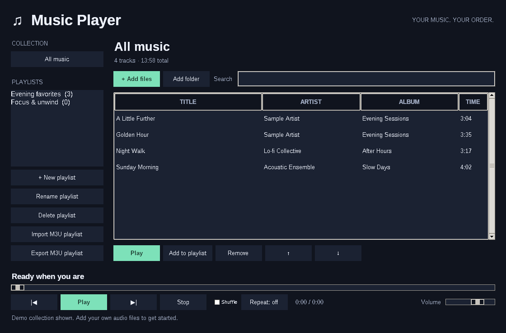

# Music Player with Playlist Management

A Python desktop music player built with **Tkinter**, **SQLite**, **pygame-ce / SDL_mixer**, and **Mutagen**. Play local music, organize playlists, and keep your collection between sessions. No account, cloud service, or database server is required.



## Run the Windows application

Use **Windows 10 or 11, 64-bit**. Download [deliverables/MusicPlayer.exe](deliverables/MusicPlayer.exe) with GitHub’s **Download raw file** button and open it. To download everything together, choose **Code → Download ZIP** on the repository page; the EXE is inside `deliverables/`. Keep the source and the `third_party/` license notices with the application when sharing it. Python does not need to be installed. The single-file app extracts its bundled runtime into your temporary directory at launch, so the first launch may take a few seconds.

The executable is unsigned. Windows may show a SmartScreen reputation warning; an organization distributing it broadly should sign it with its own trusted code-signing certificate. Company device policy may require IT approval.

1. Click **Add files** or **Add folder** to import MP3, WAV, OGG, or FLAC files. Folder import includes subfolders.
2. Double-click a track, select it and press Enter, or click **Play**.
3. Use Play/Pause, Previous, Next, Stop, Shuffle, Repeat, and Volume.
4. Click **New playlist**, enter a name, then add files directly to it. Or open **All music**, select tracks, and click **Add to playlist**.
5. Select a playlist to rename or delete it. Use ↑ / ↓ to move a selected track; clear search before reordering.
6. **Import M3U playlist** reads local `.m3u` / `.m3u8` files (including paths relative to the playlist). **Export M3U playlist** exports the current playlist, or the full library when All music is selected.

Search matches title, artist, and album. Ctrl/Shift select multiple tracks. Keyboard shortcuts: **Ctrl+O** add files, **Ctrl+N** create playlist, **Ctrl+F** focus search, **Enter** play the selected track.

### Playback behavior

- Playing a track snapshots the currently displayed list as the playback queue, in its displayed order. To play a changed playlist or search result, select a track and press Play.
- Repeat cycles through **off → all → one**. Repeat one applies to automatic completion; Next still skips the track.
- Shuffle chooses a different random track each time; it can revisit earlier tracks. Previous follows playback history, or restarts the current track after three seconds.
- MP3, OGG, and FLAC support seeking; WAV seeking is unavailable in SDL_mixer. The app explains this when you try it. Actual decoder support also depends on the file's encoding; DRM-protected and streaming music are not supported.
- If a file was moved or deleted, playback reports the problem. Remove the stale entry and add the file from its new location. An unavailable audio device can be retried by pressing Play.

## Data and backups

On Windows, the database is `%LOCALAPPDATA%\MusicPlayer\library.sqlite3`. Logs are alongside it in `music-player.log`. Volume is saved when the app closes. On Linux, data is under `~/.local/share/MusicPlayer`.

SQLite stores file paths, metadata, playlists, track order, and settings. **Audio files are referenced, not copied into the database.** Removing a track from a playlist affects only that playlist. Removing a library track removes its playlist memberships. Neither action deletes audio files. Deleting a playlist preserves the library.

Close the app before copying `library.sqlite3` for backup. To move the collection to another computer, copy the music files too and preserve their paths, or export and edit/import M3U playlists for the new locations. Exported M3U files use absolute paths and do not contain audio data. Standard M3U does not support filenames containing line breaks.

## Run from source

Install Python **3.12 x64** with Tcl/Tk (the default python.org Windows installation). In a terminal at the repository root:

```powershell
py -3.12 -m venv .venv
.venv\Scripts\python -m pip install -r requirements.txt
.venv\Scripts\python main.py
```

Linux/macOS development uses the equivalent `python3.12 -m venv .venv` and `.venv/bin/python` commands. Linux requires a desktop display, Tcl/Tk, and an available audio output device. SQLite is included in Python.

## Build a Windows EXE

On a Windows computer with Python 3.12 x64, run from the repository root:

```powershell
powershell -ExecutionPolicy Bypass -File scripts/build_windows.ps1
```

This creates a virtual environment, installs the build dependencies, runs the tests, packages **`dist/MusicPlayer.exe`** with PyInstaller, and creates **`release/MusicPlayer-Windows-x64.zip`** with source and license notices. `ExecutionPolicy Bypass` applies only to this invocation of the repository's build script; company policy may prohibit it. You can instead run the script using your organization's approved execution policy.

The `.github/workflows/windows-build.yml` workflow does the same on a Windows GitHub Actions runner, then exercises the **packaged EXE**, and uploads `MusicPlayer-Windows-x64`. Once the repository changes are pushed, open GitHub's **Actions → Test and build Windows EXE → successful run → Artifacts** to download it. Workflow dispatch is also supported. No repository secrets are required.

PyInstaller uses the current platform's runtime. A normal Linux PyInstaller build produces a Linux executable, not a Windows EXE. The supplied initial EXE was built using Windows Python under Wine; see `VALIDATION.md` for precisely what was verified.

## Test

```powershell
.venv\Scripts\python -m unittest discover -s tests -v
```

Tests cover database persistence, playlist lifecycle, ordering, duplicates, M3U paths, missing files, queue navigation, shuffle, repeat, seek, volume, failures, real SDL audio playback, and the Tk interface. Audio integration uses SDL's dummy device, so tests don't produce sound. The GUI test requires a graphical display and is skipped if none is available. On a Linux CI machine with Xvfb use `xvfb-run -a .venv/bin/python -m unittest discover -s tests -v`.

To test the packaged application and write a JSON report:

```powershell
$p = Start-Process .\dist\MusicPlayer.exe -ArgumentList '--self-test', "$PWD\self-test.json" -PassThru -Wait
Get-Content self-test.json
```

This test uses temporary audio/database files, opens the real UI, checks playlist persistence and playback with a dummy device, then exits. It does not change the user's library.

## Project structure

| Path | Purpose |
| --- | --- |
| `main.py` | Application entry point and explicit packaged self-test |
| `music_player/app.py` | Tkinter UI and user actions |
| `music_player/library.py` | SQLite schema, queries, metadata, M3U exchange |
| `music_player/playback.py` | SDL backend, playback clock, and queue state |
| `music_player/smoke.py` | Bundled-application self-test |
| `tests/` | Unit and integration tests |
| `MusicPlayer.spec` | PyInstaller one-file, windowed build |
| `scripts/build_windows.ps1` | Repeatable Windows build |

See `THIRD_PARTY_NOTICES.md` for dependency licensing information. Music files are supplied by the user.
